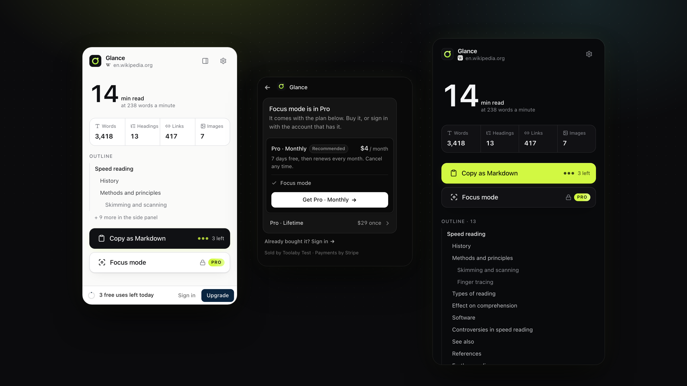

<p align="center">
  
</p>

# Glance, a Chrome extension starter that takes payments

A [WXT](https://wxt.dev) + React starter for Chrome extensions you want to charge for. It is a finished extension, not an empty template: Glance shows how long a page takes to read, its word count and its outline, copies the page as Markdown, and dims everything but the article in Focus mode.

Glance charges the three ways most extensions do, so you can keep the one you need and delete the rest:

| | In Glance | How |
| --- | --- | --- |
| Free | Read time, words, outline | No check at all |
| Free a few times a day | Copy as Markdown, 3 a day | `toolaby.gate()` counts each use |
| Paid only | Focus mode | `toolaby.gate({ feature: 'focus' })` |

Sign-in, checkout, subscriptions, lifetime licences, the paywall and the customer portal come from [Toolaby](https://toolaby.app). Buyers pay through Stripe, into your own Stripe account.

## Start

```bash
npx degit Toolaby/chrome-extension-starter my-extension
cd my-extension
npm install
npm run setup
npm run dev
```

`npm run setup` signs you in to Toolaby, makes your tool with a Free plan (3 copies a day) and a Pro plan ($4 a month or $29 once, with Focus mode), and wires this folder to it. It runs on Test, where nothing is charged: buy Pro with the card `4242 4242 4242 4242`, any future date and any code.

`npm run dev` opens Chrome with the extension loaded and reloads it as you edit. Click its icon on any article.

## What is in it

- A popup, a side panel that follows you from tab to tab, a settings page and a welcome page that opens on install. React 19, Tailwind CSS 4 and Motion, in light and dark, with the Geist font bundled in the extension rather than fetched.
- No host permissions. Glance reads a page through `activeTab` when you click its icon there, and Focus mode is a content script injected only when you turn it on. Chrome installs it without the "read and change all your data" warning. The side panel asks for wider access only when you choose "Allow on every site".
- Typed messages between the pages and the background (`lib/messages.ts`): rename an action and every caller stops compiling.
- Settings synced across the person's computers, and a list of pages read lately, with WXT's storage.
- Toolaby's paywall, sign-in and account bar in front of your popup and side panel, in your colours (Branding in the dashboard).
- Tests for the page reading and the Markdown converter (Vitest), and a GitHub Actions workflow that type-checks, tests and builds every push.
- `TOOLABY.md` and skills that coding agents read. With Toolaby's MCP server (`npx -y toolaby@latest agents`), you can ask Claude Code, Cursor or Codex for "a yearly Pro plan at $29" or "make the side panel a Pro feature", and it changes both the code and your plans.

## How the paid parts work

The background decides. Each action that costs something asks Toolaby first, and sends the refusal back to the page that asked:

```ts
// entrypoints/background.ts
async focus({ tabId }) {
  const permit = await toolaby.gate({ feature: 'focus' });
  if (!permit.allowed) return { ok: false, permit };
  // ...turn Focus mode on
}
```

The page shows the paywall with that refusal. It lists only the plans that include Focus mode, or the free uses left, or the sign-in:

```tsx
// components/glance/actions.tsx
const r = await send('focus', { tabId });
if (!r.ok && 'permit' in r) return toolaby.showPaywall(r.permit);
```

For display, `toolaby.has('focus')` answers from the device without a request, which is how the button shows its lock. It never replaces `gate()`: code on someone's computer can be edited, so the background checks again at the action.

A purchase made in another window shows at once: `useToolaby()` in `hooks/use-toolaby.ts` listens for the change.

## Make it yours

1. Name it: `manifest.name` and `description` in `wxt.config.ts`, and `name` in `package.json`.
2. Colour it: the tokens at the top of `assets/styles.css`. One block for light, one for dark. Set the same accent under Branding in your Toolaby dashboard, so the paywall matches.
3. Draw your icon in `assets/brand/icon.svg`, then render it:
   ```bash
   for s in 16 32 48 128; do rsvg-convert -w $s -h $s assets/brand/icon.svg -o public/icon/$s.png; done
   ```
4. Replace the feature: `lib/page.ts` reads the page, `entrypoints/background.ts` runs the actions, `components/glance/` draws them.
5. Price it in the dashboard, or ask your agent. The extension reads the Free plan and the plans at its next check, with no new build.

## Layout

```
entrypoints/
  background.ts         the actions, behind toolaby.gate()
  focus.content.ts      Focus mode, injected on demand
  popup/                the popup
  sidepanel/            the side panel
  options/              settings, with the person's plan
  welcome/              opens once, on install
components/
  glance/               Glance's own pieces: insights, outline, actions
  ui/                   buttons, the Pro badge, meter, switch, toasts
hooks/                  useToolaby, useInsights, useStored, useTheme
lib/                    page reading, messages, settings, formatting
modules/toolaby.wxt.ts  Toolaby's WXT module (written by setup; do not edit)
toolaby.*               Toolaby's client and config (written by setup; do not edit)
tests/                  Vitest
```

`npx -y toolaby@latest upgrade <tool-id>` replaces Toolaby's files with the current ones and leaves yours alone.

## Ship it

On Live, buyers pay for real. Connect Stripe under Configure → Payments in the dashboard first, then:

```bash
npx -y toolaby@latest login --live
npx -y toolaby@latest copy-to-live <tool-id>      # your tool, plans and features, onto Live
npx -y toolaby@latest upgrade <tool-id> --live    # the Live key into toolaby.config.js
npm run zip                                       # .output/glance.zip
```

Upload the zip in the [Chrome Web Store developer dashboard](https://chrome.google.com/webstore/devconsole). `npm run zip` refuses a build that still holds a Test key, and leaves out source maps, `.env` files and keys.

## Toolaby's price

On Toolaby's free Hobby plan, Toolaby takes 0.5% of each sale. On Pro, $25 a month per workspace, it takes nothing from sales. Stripe's own fees apply either way. See [pricing](https://toolaby.app/#pricing) and [where the money goes](https://toolaby.app/docs/money).

The extension's code is yours. To sell through something else, delete `toolaby.*`, `toolaby-*.html`, `toolaby-*.js` and `modules/toolaby.wxt.ts`, and replace the three calls in `entrypoints/background.ts` and `components/glance/actions.tsx`.

## Commands

| | |
| --- | --- |
| `npm run setup` | Your Toolaby tool, made and wired (`-- --tool <id>` wires an existing one) |
| `npm run dev` | Chrome with the extension loaded, reloading as you edit |
| `npm run build` | A production build in `.output/chrome-mv3` |
| `npm run zip` | The Chrome Web Store zip |
| `npm run check` | Types and tests, as CI runs them |

Debugging the popup: open `chrome-extension://<id>/popup.html?tab=<tab id>` in a tab of its own, with DevTools beside it. It reads that tab instead of the active one. The side panel takes the same `?tab=`.

## License

MIT. Use it, change it, sell what you build with it.
